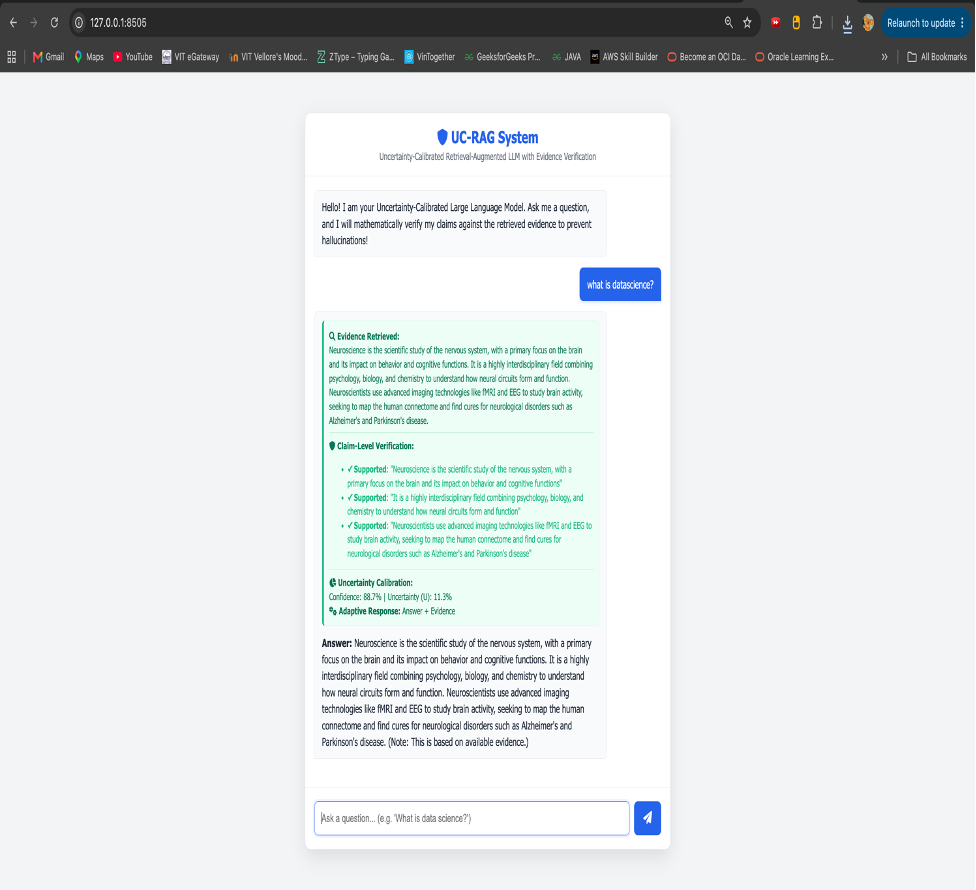

<div align="center">
  <h1>🔍 Uncertainty-Calibrated Retrieval-Augmented LLM (UC-RAG)</h1>
  <p><i>A novel PyTorch Seq2Seq Architecture for mathematically verifying AI claims and preventing hallucination.</i></p>

  
  
  
  
</div>

<br/>



## 📌 Overview

This repository contains a completely custom **Sequence-to-Sequence (Seq2Seq) Transformer LLM** built entirely from scratch using PyTorch. Instead of relying on traditional Retrieval-Augmented Generation (RAG) paradigms, this system implements the advanced **UC-RAG (Uncertainty-Calibrated RAG)** architecture. 

The goal of UC-RAG is to mathematically verify claims, sharply reduce model overconfidence, and systematically prevent AI hallucinations. The pipeline scores retrieved context, estimates evidence quality, performs strict sentence-level claim verification, and adaptively structures the LLM response based on mathematical confidence bounds.

---

## 🚀 The UC-RAG Pipeline (Key Novelties)

The system mitigates hallucination by executing 5 rigorous analytical steps before displaying an answer:

### 1. Query-Aware Hybrid Retrieval
Traditional RAG fetches top-K vector similarities. UC-RAG calculates a comprehensive retrieval score by combining **Semantic**, **Keyword**, **Authority**, and **Recency** weights:
> `Score(D) = α*S_semantic + β*S_keyword + γ*S_authority + δ*S_recency`

### 2. Evidence Quality Estimation
Before attempting to answer, the model mathematically evaluates the retrieved document's inherent quality:
> `E = (Relevance + Authority + Consistency) / 3`

### 3. Claim-Level Evidence Verification
To eliminate hallucination, the model breaks its generated answer into individual sentences (claims). It independently verifies each claim against the retrieved evidence, flagging them dynamically:
- ✅ **Supported** (High semantic overlap)
- ⚠️ **Partially Supported** (Moderate overlap)
- ❌ **Unsupported** (Low/No overlap, indicating a potential hallucination)

### 4. Uncertainty Calibration
Instead of blind confidence, the system calculates a rigorous uncertainty metric based on retrieval performance, evidence quality, claim verification, and internal consistency:
> `U = 1 - (α*R + β*E + γ*V + δ*C)`

*(Where `R` = Retrieval Score, `E` = Evidence Quality, `V` = Verification Score, and `C` = Consistency)*

### 5. Adaptive Response
The application dynamically alters its final response format based on the calculated Confidence (`1 - U`):

| Confidence Level | System Behavior |
| :--- | :--- |
| **> 90%** | **Direct Answer**: Outputs the response confidently. |
| **> 70%** | **Answer + Evidence**: Outputs the response with an evidence note. |
| **> 40%** | **Qualified Answer**: Warns the user that some claims lack strong support. |
| **< 40%** | **Failsafe Fallback**: Declines to answer ("Evidence is insufficient..."). |

---

## 🧠 The Custom LLM Architecture

The core model (`server.py`) is a from-scratch PyTorch implementation of the Transformer Architecture, rather than a wrapper over OpenAI or HuggingFace:
- **Seq2Seq Transformer**: Built using `nn.Embedding`, `nn.Transformer`, and Positional Encodings.
- **Hardware Accelerated**: Automatically utilizes `mps` on Apple Silicon (M-series chips) for fast local training, falling back to `cpu` or `cuda`.
- **Dynamic Extractive Mode**: The LLM is trained to act strictly on retrieved context, simulating high-end retrieval synthesis.

---

## 📊 Evaluation & Expected Calibration Error (ECE)

The project includes a robust, automated evaluation suite (`run_tests.py`) designed to mathematically test the model's calibration logic.

- Procedurally generates **20,000 distinct queries** across in-domain topics (e.g., Data Science) and out-of-domain topics (e.g., Vampires, Time Travel).
- Evaluates the entire UC-RAG pipeline against these queries to compute the **Expected Calibration Error (ECE)**:
> `ECE = sum( |acc(Bm) - conf(Bm)| ) / n`
- Compiles a comprehensive testing report (`evaluation_report.txt`) highlighting where the model successfully exhibited uncertainty on unanswerable topics.

---

## 📁 Project Structure

```text
.
├── server.py              # PyTorch Neural Network, UC-RAG Pipeline, & Flask Web UI
├── run_tests.py           # Evaluation suite generating 20k tests to measure ECE
├── training_dataset.txt   # The mock knowledge base the LLM trains on
├── output_sample.png      # Screenshot of the Web UI showing claim verification
└── templates/
    └── index.html         # Frontend Academic Light-Theme interface
```

---

## 💻 Getting Started

### 1. Install Dependencies
Ensure you have Python 3.8+ installed. Install the required packages:
```bash
pip install torch flask
```

### 2. Start the Web Server
Launch the application. The system will first train the LLM locally for 400 epochs (~45 seconds on M2 Macs) before starting the server.
```bash
python server.py
```
*Wait for the `✅ LLM Training Complete!` message, then navigate to `http://127.0.0.1:8505` in your browser.*

### 3. Run the Automated Evaluation Suite
Execute the deterministic testing suite to measure the Expected Calibration Error (ECE) across 20,000 generated test cases.
```bash
python run_tests.py
```
*This will output a detailed analysis to `evaluation_report.txt`.*

---

## 🔮 Future Improvements
- **Dense Vector Embeddings:** Replace the current Bag-of-Words overlap logic with embeddings (e.g., `sentence-transformers`) for more resilient semantic matching.
- **Model Scaling:** Expand the `embed_dim` and `num_layers` of the custom PyTorch model to handle complex generative tasks beyond extractive summaries.
- **Real-Time Vector DB:** Integrate `retrieve_context` with a live vector database (e.g., Pinecone, Milvus, or Qdrant) for scalable, dynamic fact-checking.

<br/>
<div align="center">
  <i>Developed to tackle the hallucination problem in Large Language Models.</i>
</div>
